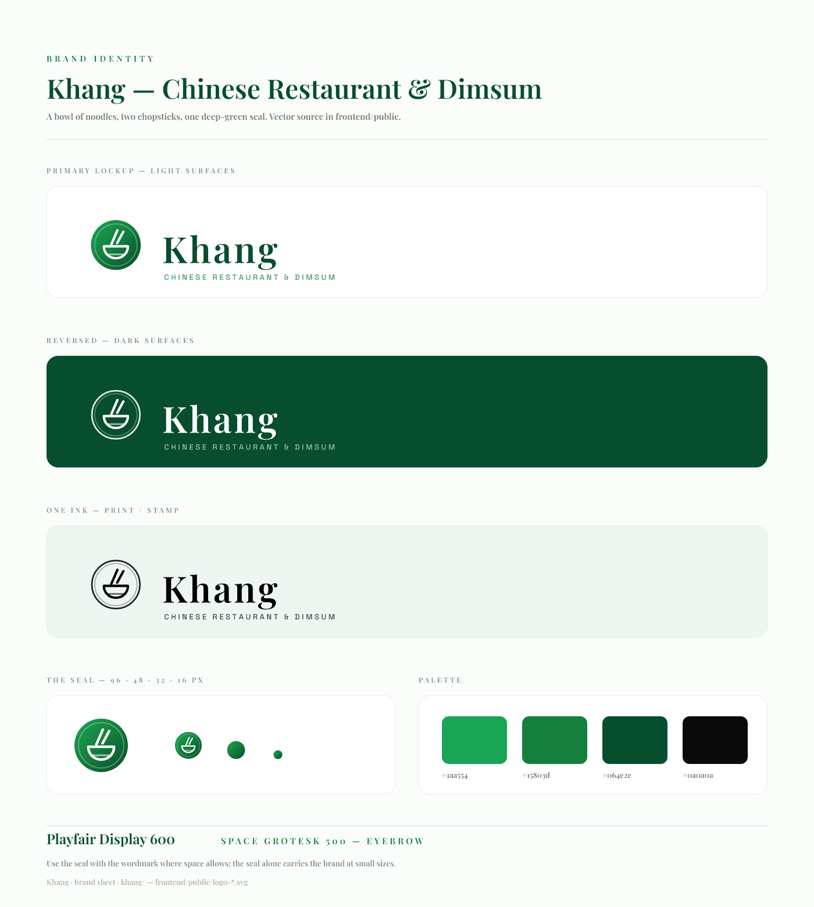

# Khang — brand sheet

A bowl of noodles, two chopsticks, one deep-green seal. Everything here is
vector, drawn from primitives, so it stays crisp from a 16 px favicon to a
shopfront sign.



## Files

| File | Use |
| --- | --- |
| `mark.svg` | The seal on its own — favicon, app icon, social avatar, stamp |
| `wordmark.svg` | “Khang” only, currentColor — tight spaces, print, merch |
| `logo-primary.svg` | Seal + wordmark + tagline, dark ink on light backgrounds |
| `logo-reversed.svg` | Seal + wordmark + tagline, white on `#064e2e` and darker |
| `logo-mono.svg` | One ink, `currentColor` — receipts, stamps, single-colour print |

The same geometry ships in the frontend so the app never depends on a font:

- `frontend/public/logo-mark.svg`, `favicon.svg`, `logo-lockup.svg`,
  `logo-lockup-light.svg`, `logo-lockup-mono.svg`, `wordmark.svg`
- `frontend/src/components/brand/KhangLogo.tsx` → `<KhangLogo />`, `<KhangMark />`

```tsx
import KhangLogo, { KhangMark } from "./brand/KhangLogo";

<KhangLogo />                          // navbar lockup (dark ink)
<KhangLogo tone="light" />             // footer, on deep green
<KhangLogo variant="mark" size={32} /> // seal only
```

## Palette

| Token | Hex | Where |
| --- | --- | --- |
| Jade | `#1aa554` | Seal highlight |
| Khang green | `#15803d` | Primary, tagline |
| Deep forest | `#064e2e` | Wordmark, footer, seal shadow |
| Ink | `#0a0a0a` | Body copy, the intro illustration |

## Type

- **Playfair Display 600** — the wordmark, tracked +5.5%.
- **Space Grotesk 500** — the “CHINESE RESTAURANT & DIMSUM” eyebrow, tracked +27%.

## Rules

1. Keep the seal a circle; never stretch or recolor it outside the palette.
2. Minimum sizes: seal 16 px, lockup 120 px wide.
3. Clear space around the lockup = the height of the seal's inner bowl.
4. On photography, use `logo-reversed.svg` over a darkened area — never place
   the green seal on a busy mid-tone.

## Why no 康?

The Chinese character depended on a web font (`Ma Shan Zheng`) that many
devices either block or fail to load, so the mark was replaced with drawing.
The name, the tagline and the palette are unchanged.
